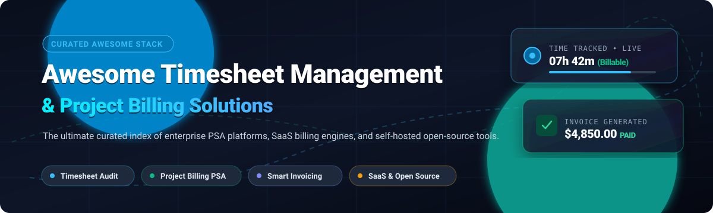

# ⏱️ Awesome Timesheet Management & Project Billing 💼

**🚀 A comprehensive, SEO-optimized directory of top-tier Timesheet Management, Professional Services Automation (PSA), and Project Billing platforms.**  
✨ Explore both commercial cloud SaaS powerhouses and privacy-focused, self-hosted open-source alternatives for tracking billable hours, monitoring project profitability, controlling labor budgets, and generating compliant client invoices. 📊

---

## 📋 Table of Contents

- [📈 Sector Overview & Market Dynamics](#-sector-overview--market-dynamics)
- [🟦 SaaS / Hosted Platforms](#-saas--hosted-platforms)
- [🟩 Open-Source Software](#-open-source-software)
- [📊 Comparison at a Glance](#-comparison-at-a-glance)
- [🔍 Feature Evaluation Checklist](#-feature-evaluation-checklist)
- [💖 Support](#-support)
- [🌟 Star History](#-star-history)
- [🤝 Contributing](#-contributing)
- [📄 License](#-license)

---

## 📈 Sector Overview & Market Dynamics

The global time-tracking, timesheet management, and project billing software market is valued at approximately **$5.8B to $6.5B** 💰 and is projected to surpass **$18B+ to $23B** over the next decade, expanding at a robust CAGR of **13%–15.6%** 🚀. 

The sector is **highly fragmented** 🧩 rather than a winner-take-all monopoly: low barriers to entry have catalyzed hundreds of specialized niche solutions (spanning creative agency trackers, legal compliance timers, and construction GPS field tools), while massive enterprise PSA suites and ERP vendors continuously acquire high-growth players to combat revenue leakage and support hybrid-work labor regulations 🌐.

---

## 🟦 SaaS / Hosted Platforms

Below is a breakdown of commercial, cloud-hosted Timesheet Management and Project Billing platforms. The table is ranked by company scale (valuation / annual revenue, descending) 🏆.

| 🏢 Platform | 🎯 Type / Focus | 💎 Company Scale (Revenue / Valuation) | 💵 Pricing (Starting Tier) | 🎁 Free Tier Limits / Free Trial Constraints | 🌟 Best For |
|:---|:---|:---|:---|:---|:---|
| [**Zoho Timesheet**](https://www.zoho.com/projects/timesheet.html) | Project Management & Ecosystem Billing 🔄 | **~$1.4B–$1.5B ARR** ($10B–$12.5B est. valuation) | **$5/user/month** (Premium tier on Zoho Projects, billed annually) | **Forever-free plan:** Free on Zoho Invoice (up to 3 users, basic time tracking). On Zoho Projects, free plan is limited to 5 users & 3 projects, but timelogs require paid upgrade (10-day free trial on paid plans). | Teams already utilizing Zoho Books or Zoho Projects for accounting 📚 |
| [**Replicon**](https://www.replicon.com/) (Deltek) | Enterprise PSA & Time Intelligence 🧠 | **$447.5M Acquisition** (Integrated into Deltek / Roper Technologies) | **$6/user/month** (Time & Attendance, min. 10 users; PSA modules from $29/user/month) | **No self-service free tier or open trial:** Evaluation requires a scheduled sales consultation and guided enterprise demo. | Mid-market and large enterprises needing global compliance and payroll integration 🌐 |
| [**Harvest**](https://www.getharvest.com/) | Time Tracking & Client Invoicing 🧾 | **~$120M–$150M ARR** (Private equity backed) | **$10.80/user/month** ($9/user/month billed annually) | **Forever-free plan:** Strictly capped at 1 seat and 2 active projects (no invoice attachments, file imports, or integrations). Offers a 30-day fully featured free trial (no credit card required). | Agencies and consultancies seeking fast time logging and Stripe-integrated invoicing ⚡ |
| [**BigTime**](https://www.bigtime.net/) | Professional Services Automation (PSA) 🛠️ | **$100M Growth Round** (Vista Equity Partners, ~$40M–$50M ARR) | **$20/user/month** (Express plan; Premier with custom rates is quote-based) | **No permanent free tier:** Offers no open self-service trial; trial evaluation is arranged via sales-guided demo. | Professional services firms (accounting, legal, consulting) needing PSA workflows 💼 |
| [**BQE CORE**](https://www.bqe.com/) | Project Accounting & Billing Automation 🏗️ | **~$50M–$55M ARR** (Serent Capital backed) | **~$22/user/month** (Modular quote-based pricing; implementation sold separately) | **No permanent free tier:** Offers a 14-day free trial on select modules (no credit card required) or assisted sales walkthrough. | Architecture, engineering, and CPA firms requiring DCAA/audit-compliant job costing 📐 |
| [**Scoro**](https://www.scoro.com/) | End-to-End Work Management & PSA 📊 | **~$20M–$23.4M ARR** (~$66M valuation after Series B) | **$26/user/month** ($19.90/user/month billed annually; 5-seat minimum) | **No permanent free tier:** Offers a 14-day fully featured free trial (no credit card required; requires 5-seat minimum on conversion). | Full-service agencies wanting end-to-end pipeline-to-project revenue visibility 🔍 |
| [**ClickTime**](https://www.clicktime.com/) | Time Tracking & Labor Cost Analytics ⏱️ | **~$6.5M–$10M ARR** (~$64.7M estimated valuation) | **$13/user/month** ($10/user/month billed annually; Starter tier) | **No permanent free tier:** Provides a 14-day free trial on Starter/Team tiers (no credit card required) with access to core reports. | Organizations focused on tracking project labor costs against fixed operational budgets 📉 |
| [**Paymo**](https://www.paymoapp.com/) | Project Management & Task Timers ⏳ | **~$2.5M–$3.7M ARR** (Bootstrapped / self-funded) | **$9.95/user/month** ($5.95/user/month billed annually; Starter plan) | **Forever-free plan:** Strictly capped at 1 user, 1 client, 2 active projects, and 1 GB storage (includes unlimited time tracking and invoices). | Solo freelancers and boutique digital studios tracking daily task time 🎨 |
| [**Avaza**](https://www.avaza.com/) | All-in-One Projects, Timesheets & Invoicing 📦 | **~$2.2M ARR** (Bootstrapped / self-funded) | **$11.95/month base** (Includes 2 time/expense users; $7/month per additional user) | **Forever-free plan:** Limited to 1 timesheet/expense user, 5 active projects, 10 clients, 5 invoices/month, and 100 MB storage. | Small creative studios and remote agencies wanting an all-in-one suite 🤝 |

---

## 🟩 Open-Source Software

Self-hosted, transparent, and community-driven Timesheet Management and Project Billing systems. Sorted in descending order by GitHub Stars_Count ⭐.

| 💻 Software & Repository | ⭐ GitHub_Stars | 🛠️ Stack | 🧾 Invoicing Support | 💰 Project Budgeting & Billing | 📜 License | 🚀 Deployment | 💡 Key Highlights |
|:---|:---:|:---|:---:|:---:|:---|:---|:---|
| [**Super Productivity**](https://github.com/super-productivity/super-productivity) |  | TypeScript / Electron / Angular | ❌ (Export only) | ⚠️ (Task-level) | MIT | Desktop / Web / Android | Advanced personal and developer time tracker with Jira, GitLab, and OpenProject bi-directional sync 🔄 |
| [**ActivityWatch**](https://github.com/ActivityWatch/activitywatch) |  | Python / Rust / Vue | ❌ | ❌ | MPL-2.0 | Native Desktop (Win/macOS/Linux) | Automatic, privacy-first background time logging with local window/browser activity categorization 🛡️ |
| [**Invoice Ninja**](https://github.com/invoiceninja/invoiceninja) |  | PHP (Laravel) / Flutter | ✅ (Multi-gateway, PDF, e-invoicing) | ✅ (Task & project billing) | AGPL-3.0 / Fair Source | Docker / Self-hosted / Cloud | Industry-standard open-source invoice and payment engine with integrated timesheets and client portals 💳 |
| [**SolidTime**](https://github.com/solidtime-io/solidtime) |  | PHP (Laravel) / Vue 3 / Tailwind | ⚠️ (Billing rates & CSV export) | ✅ (Hourly rates & team budgets) | AGPL-3.0 | Docker Compose | Modern, ultra-clean open-source alternative to Toggl Track and Clockify with multi-org billable rates ✨ |
| [**Ever Gauzy**](https://github.com/ever-co/ever-gauzy) |  | TypeScript / NestJS / Angular | ✅ (Recurring & multi-currency) | ✅ (Full project costing & ERP) | AGPL-3.0 | Docker / Kubernetes / Cloud | Comprehensive business management ERP/HRM with automated employee timelogs, screenshots, and billing 🏢 |
| [**Kimai**](https://github.com/kimai/kimai) |  | PHP (Symfony) / Doctrine / Bootstrap | ✅ (Custom PDF/HTML/Office export) | ✅ (Rate hierarchies & budgets) | AGPL-3.0 | Docker / On-Premise / SaaS | The gold standard of open-source timesheet management with 30+ languages, LDAP/SAML, and extensive REST API 🥇 |
| [**InvoicePlane**](https://github.com/InvoicePlane/InvoicePlane) |  | PHP / MySQL | ✅ (Quotes, invoices, 25+ gateways) | ⚠️ (Basic hourly tracking) | MIT | LAMP / Docker | Veteran self-hosted client billing and quote management system tailored for solo practitioners and SMEs 📄 |
| [**Timestrap**](https://github.com/overshard/timestrap-django) |  | Python (Django) / Vue | ✅ (HTML/CSV exports) | ⚠️ (Client rate tracking) | MIT | Docker / Heroku / On-Prem | Lightweight, multi-user web timesheet and invoicing platform with fine-grained team permission controls 🔒 |
| [**TimeTracker (DRYTRIX)**](https://github.com/DRYTRIX/TimeTracker) |  | Python / SQLite / PostgreSQL | ✅ (PDF & Peppol e-invoicing) | ⚠️ (Task billing rates) | GPL-3.0 | Docker / Raspberry Pi / NAS | Privacy-first self-hosted time tracker and e-invoice generator with unlimited users and zero per-seat fees 🍓 |
| [**AlgaPSA**](https://github.com/Nine-Minds/alga-psa) |  | TypeScript (Next.js) / PostgreSQL / Redis | ✅ (Visual PDF/Quote designer) | ✅ (Contract POs, retainers & SLAs) | AGPL-3.0 (Community) | Docker Compose / ISO | Dedicated open-source PSA designed for MSPs, combining helpdesk tickets, timesheet approvals, and contracts 🎫 |
| [**Cattr**](https://github.com/cattr-app/server-application) |  | PHP (Laravel) / Vue / Docker | ⚠️ (Activity reports & API export) | ⚠️ (Project task estimations) | AGPL-3.0 | Docker / Desktop Agent | Self-hosted team tracking engine featuring periodic screen capture, activity heatmaps, and GitLab/Jira sync 📸 |

---

## 📊 Comparison at a Glance

A side-by-side capability evaluation between major SaaS systems and self-hosted open-source software 🔍:

| 🏷️ Platform | ☁️ Deployment Model | 🧾 Built-in Invoicing | 🎚️ Rate Hierarchies | ✅ Timesheet Approvals | 💰 Budget Tracking | 🌐 Client Portal |
|:---|:---:|:---:|:---:|:---:|:---:|:---:|
| **Harvest** | Cloud SaaS | ✅ Multi-currency | ✅ Person / Task / Project | ✅ Multi-level | ✅ Margin & Burn rate | ✅ Online Pay |
| **BigTime** | Cloud SaaS | ✅ Custom WIP Billing | ✅ Complex Matrix | ✅ Configurable | ✅ Advanced Gantt / Milestones | ✅ Client Access |
| **BQE CORE** | Cloud SaaS | ✅ AIA / Progress Billing | ✅ Rate Overrides | ✅ Multi-tier workflows | ✅ Job Costing / GL | ✅ Integrated |
| **Replicon** | Cloud SaaS | ✅ Polaris PSA | ✅ Role-based global rates | ✅ Audit-trail compliance | ✅ Enterprise Margin | ✅ Enterprise |
| **ClickTime** | Cloud SaaS | ⚠️ Report-based | ✅ Custom billable rates | ✅ Automated reminders | ✅ Labor cost focus | ❌ |
| **Avaza** | Cloud SaaS | ✅ Online payment links | ✅ User & Role rates | ✅ Included | ✅ Project progress | ✅ Self-service |
| **Paymo** | Cloud SaaS | ✅ Integrated payments | ✅ Hourly / Fixed | ✅ Team timesheets | ✅ Task budgeting | ✅ Included |
| **Scoro** | Cloud SaaS | ✅ Retainers & WIP | ✅ Multilevel billable rates | ✅ Integrated | ✅ Real-time profitability | ✅ Portal |
| **Zoho Timesheet** | Cloud SaaS | ✅ via Zoho Invoice/Books | ✅ Project / User rates | ✅ Manager Approvals | ✅ Budget variance | ✅ Customer Portal |
| **Invoice Ninja** | Self-Hosted / OSS | ✅ Advanced Gateway Suite | ✅ Hourly / Fixed billing | ⚠️ User permissions | ⚠️ Task tracking | ✅ Fully Featured |
| **SolidTime** | Self-Hosted / OSS | ⚠️ CSV / API | ✅ Billable / Non-billable | ⚠️ Org level | ✅ Hourly thresholds | ❌ |
| **Ever Gauzy** | Self-Hosted / OSS | ✅ Automated billing | ✅ Role & Project rates | ✅ Detailed logs | ✅ Enterprise Financials | ✅ Included |
| **Kimai** | Self-Hosted / OSS | ✅ Custom Templated Invoices | ✅ Customer / Project / Activity | ✅ Team lead approval | ✅ Budget tracking | ⚠️ Via plugin |
| **AlgaPSA** | Self-Hosted / OSS | ✅ Peppol / Tax Designer | ✅ Contract PO rates | ✅ Ticket-to-timesheet | ✅ Contract Retainers | ✅ Client Portal |
| **TimeTracker (DRYTRIX)**| Self-Hosted / OSS | ✅ Peppol & PDF | ✅ Project / Hourly | ❌ Simple timers | ❌ | ❌ |

---

## 🔍 Feature Evaluation Checklist

When selecting between commercial SaaS and open-source timesheet management and project billing solutions, evaluate these operational requirements 📝:

1. **Billing Modality Support:** 💵 Does the engine accommodate Fixed-Price milestones, Time & Materials (T&M), Retainers, and Not-to-Exceed (NTE) caps?
2. **Approval Workflows & Audit Readiness:** 📋 Does your organization require dual-signature timesheet approvals (e.g., Project Manager + Resource Manager) and immutable audit trails for compliance (e.g., DCAA, EU CCOO)?
3. **Multi-Currency & Tax Automation:** 🌍 Are invoices compatible with regional regulations (such as Peppol e-invoicing in Europe, GST in APAC, or sales taxes across US jurisdictions)?
4. **Data Sovereignty & Self-Hosting:** 🛡️ Does sensitive client hourly information need to remain on-premises behind a firewall (using tools like Kimai, SolidTime, or AlgaPSA)?
5. **Ecosystem Integrations:** 🔌 How cleanly does the platform sync time logs to accounting software (QuickBooks Online, Xero, FreshBooks, NetSuite) and task tools (Jira, GitHub, GitLab, Asana)?

---

## 💖 Support

Thank you for visiting and using this curated directory! 🙏  
If this resource helped you discover the right tool or saved you time, please consider supporting the project:

- ⭐ **Star this repository** to help others discover it!
- 🍴 **Fork it** and contribute your own discoveries via Pull Requests.
- 📢 **Share it** with fellow developers, freelancers, and finance professionals.
- ☕ **Buy me a coffee / Sponsor:** If you appreciate this work, consider supporting ongoing maintenance on the [GitHub Sponsors Dashboard](https://github.com/sponsors/ishandutta2007)! ❤️

---

## 🌟 Star History

---

## 🤝 Contributing

Contributions are warmly welcomed! 🎉 If you maintain or use an open-source Timesheet Management or Project Billing system that isn't listed here:

1. 🍴 Fork this repository.
2. 🔄 Ensure the software is actively maintained (commits or releases within the past 12 months) and possesses a valid open-source license.
3. 📝 Add the project with proper documentation links, stack info, and GitHub stargazer badge.
4. 🚀 Open a Pull Request following standard [GitHub PR guidelines](https://github.com/ishandutta2007/Awesome-Timesheet-Management-Project-Billing/pulls).

---

## 📄 License

This repository is distributed under the [Creative Commons Zero v1.0 Universal](LICENSE) (CC0 1.0) Public Domain Dedication ⚖️.  
All third-party trademarks, logos, and project names are the property of their respective owners.

  Built with care for engineers, agency leaders, and finance professionals. Star ⭐ this repo if you find it valuable!

